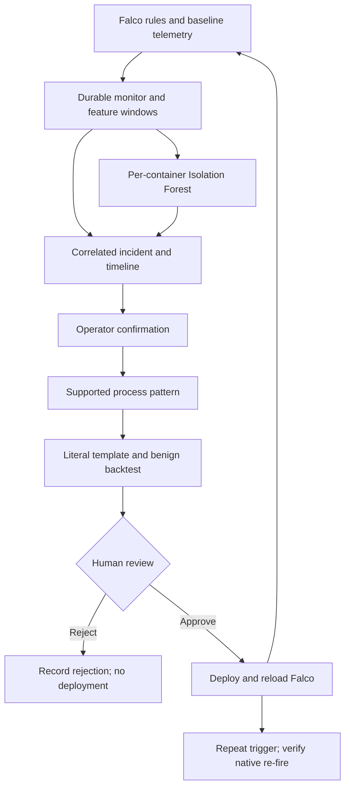

# SelfSentry

SelfSentry is a hybrid container runtime security system that combines Falco rule matching with per-container behavioral anomaly detection, correlates both into incidents, and converts confirmed anomalies into template-generated, backtested, human-approved Falco rules — demonstrating a supervised adaptive detection loop under controlled evaluation.

The implemented rule-synthesis path requires concrete process metadata from a Falco
alert; anomaly-only-to-rule synthesis is not supported yet. “Adaptive” means supervised
rule-set expansion, not autonomous deployment or automatic model retraining.
Isolation Forest remains default; One-Class SVM is experimental. Isolation is off
for the standard academic study and demo.

Start with the [academic evidence pack](docs/academic_evidence_pack.md):
[mini-study](docs/academic_study.md), [case matrix](docs/academic_case_matrix.md),
[evaluation interpretation](docs/academic_evaluation.md),
[timed demo](docs/demo_script.md), and [viva/report guide](docs/academic_narrative.md).
The [15 October study](docs/academic_results_20261015.md) records one complete approved
rule re-fire chain, one human rejection, two failed backtest previews and three later
benign windows without rule hits. All primary behaviors already had Falco detections;
no added attack coverage is claimed. C2 recording remains deferred.

## Current status

M1–M4 features are implemented and verified on the Ubuntu/Docker/Falco/PostgreSQL VM.
M5 includes a 200-trial controlled full-pipeline evaluation and a retrospective layer
comparison: 100/100 attack detections, 13/100 benign detections, 5/100 attack auto-confirmations,
no benign auto-confirmations and no duplicate trial incidents. These are controlled results,
not production guarantees or evidence of improved attack coverage beyond Falco.

PostgreSQL recovery, no-baseline fallback, isolation/resume and protected-container workflow
checks passed. Invalid-model paths have automated coverage. The 12 October VM release checks recorded
424 Python tests, 7 frontend tests, lint and build passing; these are historical checks.
AI is advisory, optional and subject to provider limits; isolation defaults off.
See [measured results](docs/monitor_measured_results_20261011.md) and
[final review](docs/monitor_final_review.md) for evidence and unmeasured items.
Independent live comparison variants and separate layer timings were not collected.

Start with [monitor_operations.md](docs/monitor_operations.md) for exact configuration,
setup and start/stop commands. [monitor_completion_report.md](docs/monitor_completion_report.md)
lists changes and checks. [monitor_evaluation.md](docs/monitor_evaluation.md) defines the
remaining controlled measurements. [monitor_spec_checklist.md](docs/monitor_spec_checklist.md)
tracks acceptance criteria without treating unit tests as live attack measurements.

## Architecture



Image scanning and deployment policy provide supporting pre-deployment checks.
The feedback loop above is the academic focus. The model is unavailable until a valid
baseline exists. Falco alerts still reach incidents during learning. Isolation is independently configured and defaults off.
Read [the demo script](docs/demo_script.md) and [release checklist](TODO.md) for
commands, acceptance evidence and presentation limitations.

- `image-scanner`, `policy-checker`, `deployment-gate`: existing pre-deployment gate.
- `runtime-monitor`, `falco-rules`: existing normalization and baseline capture rules.
- `behavioral-engine`: existing feature extractor, JSON baseline store and Isolation Forest.
- `correlation-engine`: existing risk score and confidence-adjusted routing.
- `monitor-service`: long-running coordinator, SQLite inbox/outbox and lifecycle states.
- `backend-api`, `database`: existing FastAPI/PostgreSQL persistence, additive monitor metadata.
- `response-engine`: pause + network disconnection with recoverable state and verified outcomes.
- `rule-synthesis-engine`: existing literal templates, backtesting and human approval workflow.
- `ai-analysis`: optional, advisory incident explanation; no detection or deployment authority.
- `frontend-dashboard`: alerts, deployments, containers, audit, review queue and monitor health.

## Supervised adaptation evidence

The operator-supplied study archive was reviewed offline: 17 valid captures, unchanged
baseline, default Isolation Forest and all automatic actions off. Incident 200 became
human-approved rule 18, which natively re-fired in incident 204. Rule 19 from control
incident 203 was rejected and remained absent. Sensitive-read and terminal-shell
pattern previews matched 3/36 and 8/36 benign events and were not submitted. One
anomaly-only benign incident (199) is retained. Three later normal windows produced
no generated-rule matches or incidents; these are repeated lab workloads, not a
production FPR estimate. See the [full table and limits](docs/academic_results_20261015.md)
and [artifact audit](docs/academic_results_20261015.json).

## Dashboard screenshots

### Monitor


### Baselines and models


### Alerts


Incident 190 records controlled automatic isolation using the opt-in SVM.
The container was subsequently resumed and its bridge network restored.

### Rule review


Generated rules require human review and approval before deployment.

## Development

```bash
git clone https://github.com/guna-hash/selfsentry.git
cd selfsentry
python3 -m venv .venv
source .venv/bin/activate
python3 -m pip install -r requirements.txt
python3 -m pytest tests/ -q
(cd frontend-dashboard && npm ci && npm run build)
```

Python tests use mocks and isolated SQLite; no live AI key, Trivy download, Docker daemon or
production PostgreSQL database is needed. Running the actual service needs Linux, Docker,
Falco with `rule_matching: all`, your database URL and a shared backend write token. Isolation
defaults to disabled. Read the operations guide before enabling response on disposable containers.

## License

TBD (academic project; choose a license before public release if required).
