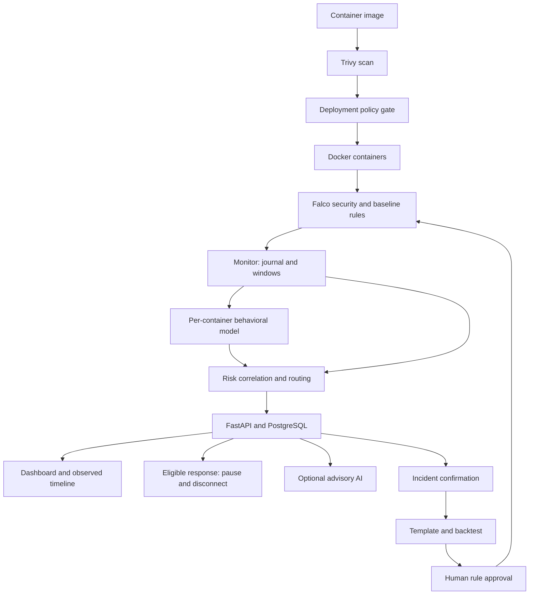
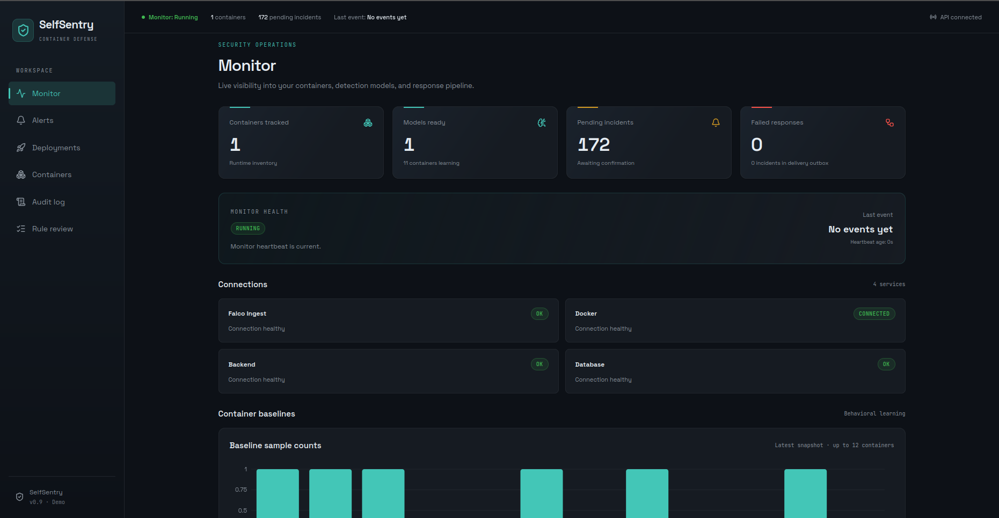
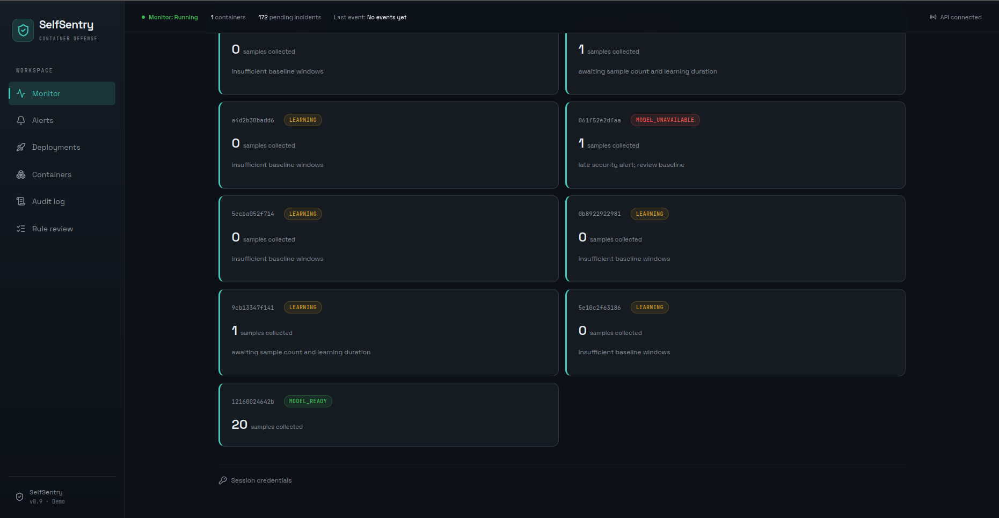
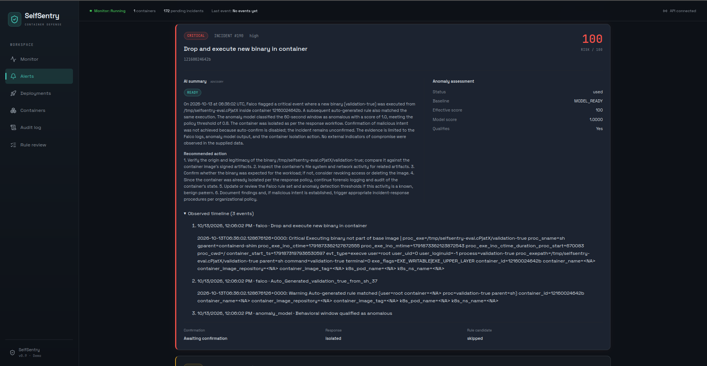
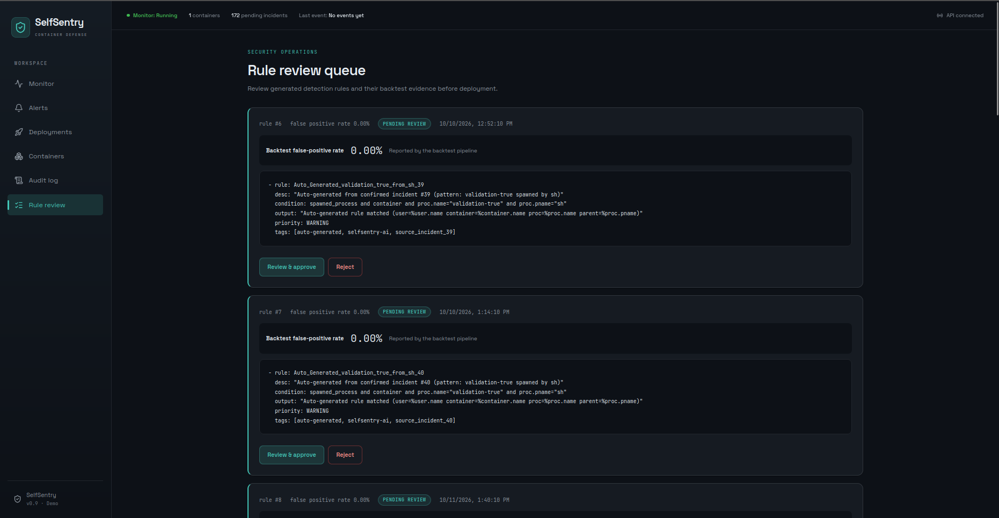

# SelfSentry

Container security monitoring and response for an academic/capstone project. Trivy scans
images; a deployment gate checks policy before starting containers. Falco and per-container
Isolation Forest models supply runtime evidence to the existing correlation/routing engine.
Confirmed incidents can produce template-generated, backtested Falco rule candidates;
every rule deployment requires explicit human approval.

## Current status

M1–M4 features are implemented and verified on the Ubuntu/Docker/Falco/PostgreSQL VM.
M5 includes a 200-trial controlled full-pipeline evaluation and a retrospective layer
comparison: 100/100 attack detections, 13/100 benign detections, 5/100 attack auto-confirmations,
no benign auto-confirmations and no duplicate trial incidents. These are controlled results,
not production guarantees or evidence of improved attack coverage beyond Falco.

PostgreSQL recovery, no-baseline fallback, isolation/resume and protected-container workflow
checks passed. Invalid-model paths have automated coverage. The reviewed Python suite has
406 passing tests. AI is advisory, optional and subject to provider limits; isolation defaults off.
See [measured results](docs/monitor_measured_results_20261011.md) and
[final review](docs/monitor_final_review.md) for evidence and unmeasured items.
Independent live comparison variants and separate layer timings were not collected.

Start with [monitor_operations.md](docs/monitor_operations.md) for exact configuration,
setup and start/stop commands. [monitor_completion_report.md](docs/monitor_completion_report.md)
lists changes and checks. [monitor_evaluation.md](docs/monitor_evaluation.md) defines the
remaining controlled measurements. [monitor_spec_checklist.md](docs/monitor_spec_checklist.md)
tracks acceptance criteria without treating unit tests as live attack measurements.

## Architecture



The model is unavailable until a valid baseline exists. Falco alerts still reach
incidents during learning. Isolation is independently configured and defaults off.
Read [the demo script](docs/demo_script.md) and [release checklist](TODO.md) for
commands, acceptance evidence and presentation limitations.

- `image-scanner`, `policy-checker`, `deployment-gate`: existing pre-deployment gate.
- `runtime-monitor`, `falco-rules`: existing normalization and baseline capture rules.
- `behavioral-engine`: existing feature extractor, JSON baseline store and Isolation Forest.
- `correlation-engine`: existing risk score and confidence-adjusted routing.
- `monitor-service`: long-running coordinator, SQLite inbox/outbox and lifecycle states.
- `backend-api`, `database`: existing FastAPI/PostgreSQL persistence, additive monitor metadata.
- `response-engine`: pause + network disconnection with recoverable state and verified outcomes.
- `rule-synthesis-engine`: existing literal templates, backtesting and human approval workflow.
- `ai-analysis`: optional, advisory incident explanation; no detection or deployment authority.
- `frontend-dashboard`: alerts, deployments, containers, audit, review queue and monitor health.

## Dashboard screenshots

### Monitor


### Baselines and models


### Alerts


Incident 190 records controlled automatic isolation using the opt-in SVM.
The container was subsequently resumed and its bridge network restored.

### Rule review


Generated rules require human review and approval before deployment.

## Development

```bash
git clone https://github.com/guna-hash/selfsentry.git
cd selfsentry
python3 -m venv .venv
source .venv/bin/activate
python3 -m pip install -r requirements.txt
python3 -m pytest tests/ -q
(cd frontend-dashboard && npm ci && npm run build)
```

Python tests use mocks and isolated SQLite; no live AI key, Trivy download, Docker daemon or
production PostgreSQL database is needed. Running the actual service needs Linux, Docker,
Falco with `rule_matching: all`, your database URL and a shared backend write token. Isolation
defaults to disabled. Read the operations guide before enabling response on disposable containers.

## License

TBD (academic project; choose a license before public release if required).
