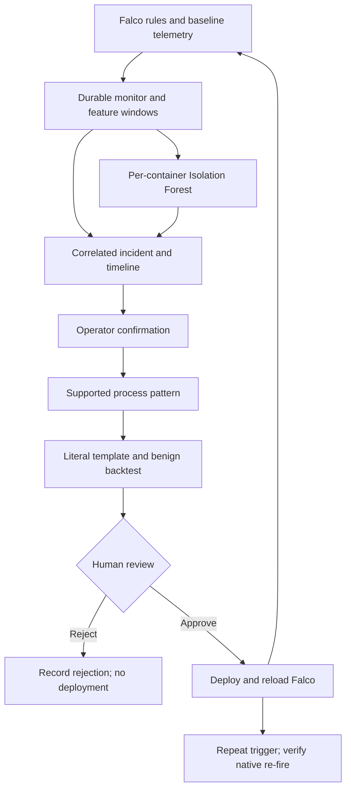
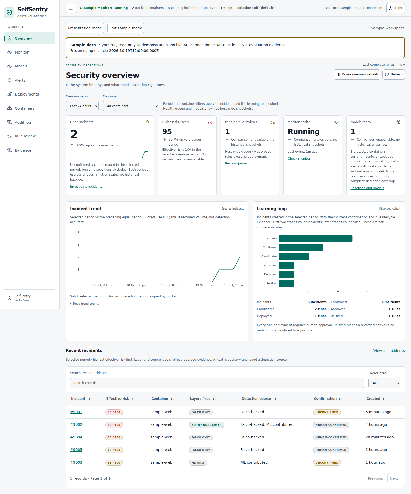
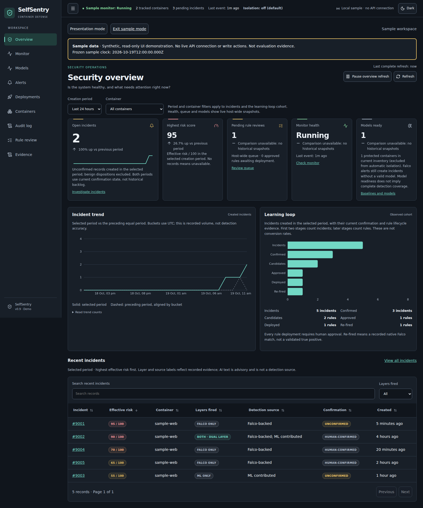
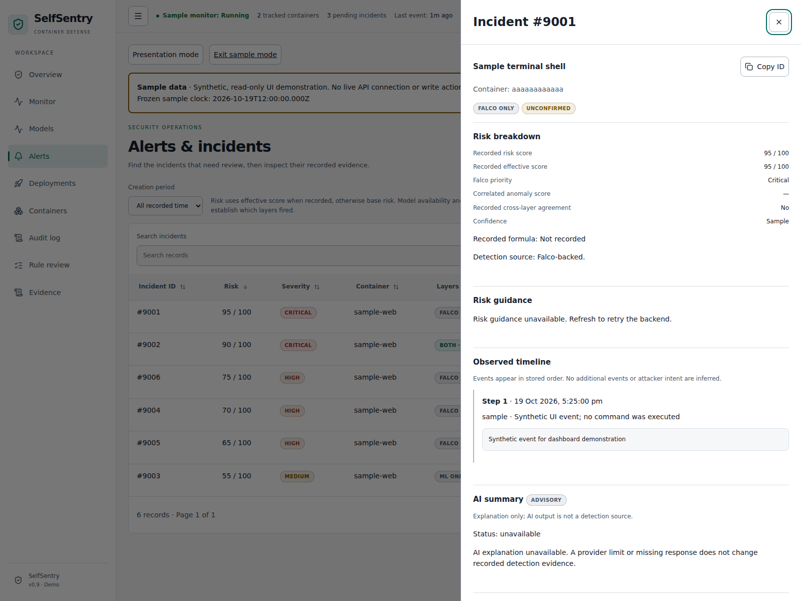
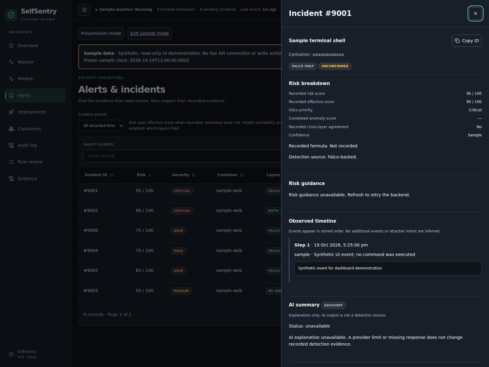
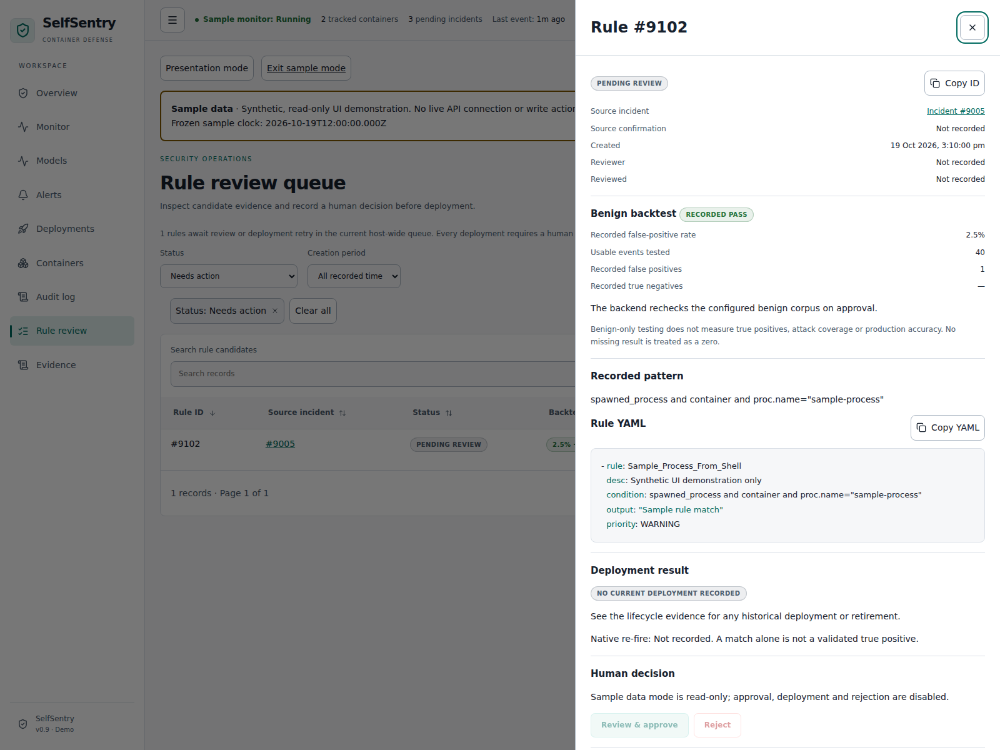
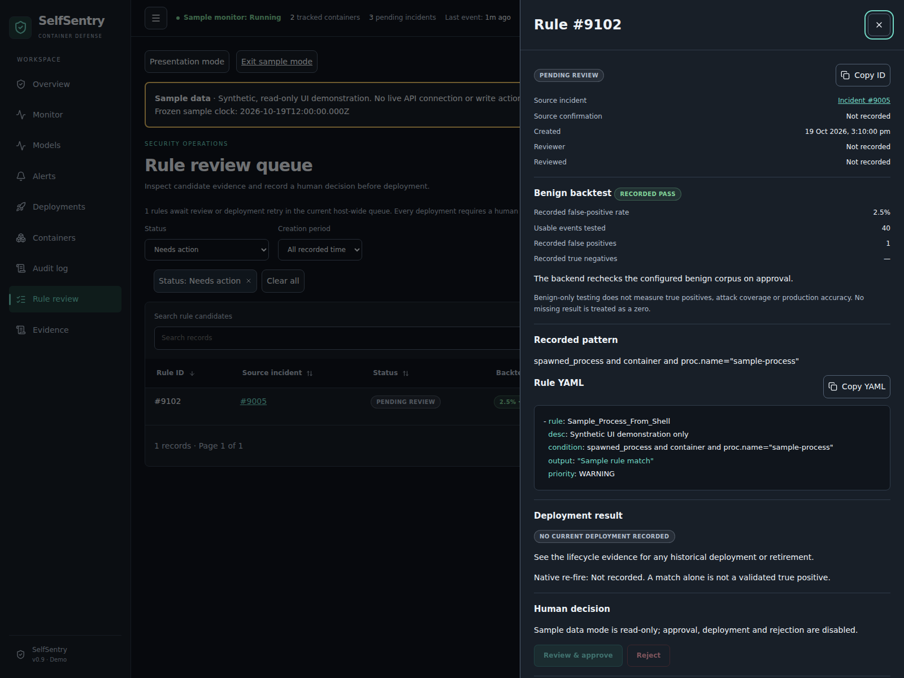
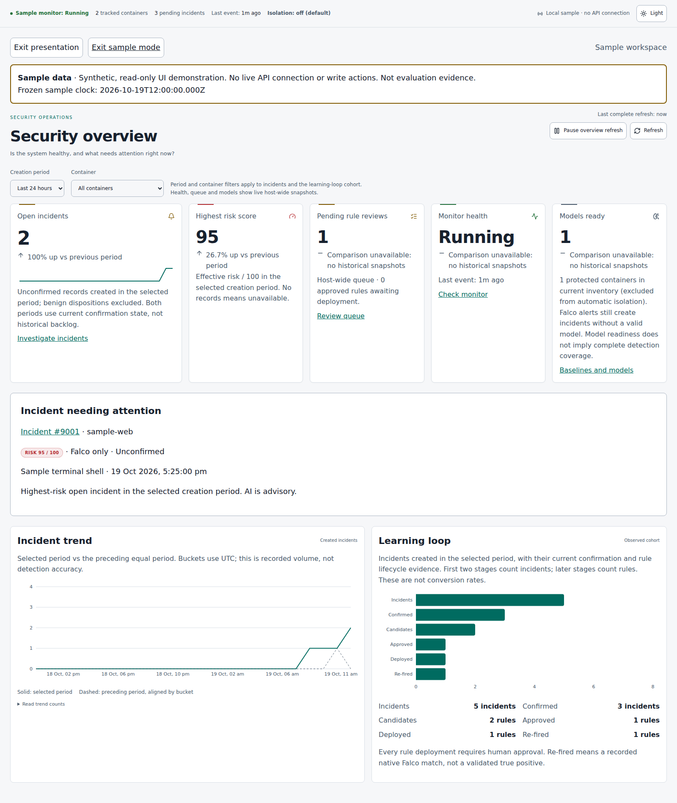
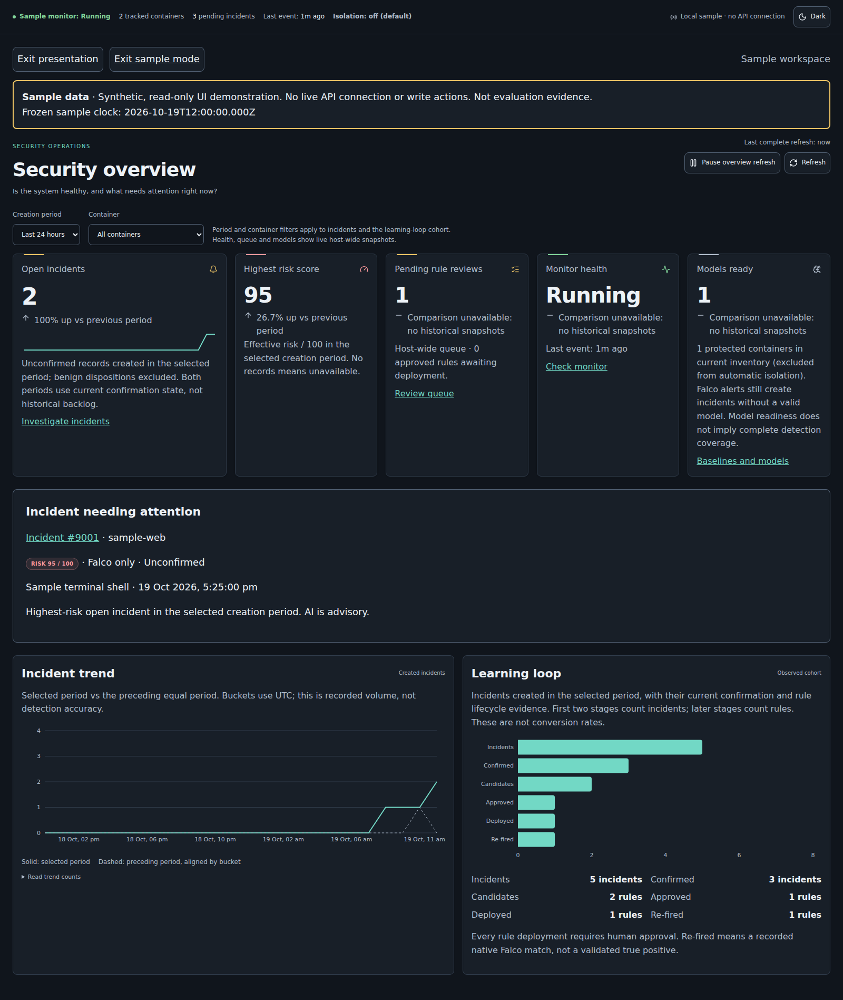

# SelfSentry

SelfSentry is a hybrid container runtime security system that combines Falco rule matching with per-container behavioral anomaly detection, correlates both into incidents, and converts confirmed anomalies into template-generated, backtested, human-approved Falco rules — demonstrating a supervised adaptive detection loop under controlled evaluation.

Rule synthesis supports literal process/parent and process/file-write templates. A ready-model
anomaly can propose a rule only when its window retains a usable syscall witness; aggregated
anomaly counts alone cannot generate a rule. Every proposal must pass an authoritative benign
backtest and human approval before deployment. “Adaptive” means supervised rule-set expansion,
not autonomous rule deployment or automatic model retraining. Isolation Forest remains the
default; One-Class SVM remains experimental. Automatic isolation defaults off.

For a configured host, start all three application processes with:

```bash
bin/selfsentry start
bin/selfsentry status
# bin/selfsentry stop
# bin/selfsentry restart
```

Install Python dependencies and build the dashboard once before starting. The command validates
PostgreSQL, Docker, Trivy, Falco configuration/log access, the benign corpus and `.env`, then
starts the backend, continuous monitor and built dashboard on localhost. See
[operations](docs/monitor_operations.md) and [Final Completion Notes](docs/final_completion_notes.md)
for setup, continuity guarantees, validation boundaries and the changes since `0dc6374`.

Every incident severity and deployment decision has stored deterministic guidance with an
explanation, risk rationale and suggested fixes. AI is optional advisory enrichment and cannot
change the deterministic severity. The dashboard overview links inventory, incident risks,
deployment decisions, rule lifecycle evidence, audit history and monitor health.

Start with the [academic evidence pack](docs/academic_evidence_pack.md):
[mini-study](docs/academic_study.md), [case matrix](docs/academic_case_matrix.md),
[evaluation interpretation](docs/academic_evaluation.md),
[timed demo](docs/demo_script.md), and [viva/report guide](docs/academic_narrative.md).
The [15 October study](docs/academic_results_20261015.md) records one complete approved
rule re-fire chain, one human rejection, two failed backtest previews and three later
benign windows without rule hits. All primary behaviors already had Falco detections;
no added attack coverage is claimed. C2 recording remains deferred.

## Current status

The completion extension has automated regression coverage and operator-reported VM passes
for startup, monitoring continuity, recovery, protection and authoritative backtest rejection.
See [16 October acceptance](docs/completion_acceptance_20261016.md). Visual inspection,
native file-rule validation and a new anomaly-only live chain remain unverified.
The historical results below apply to their recorded source versions, not automatically to
this extension. No production accuracy or additional attack coverage is inferred from unit tests.

M1–M4 features are implemented and verified on the Ubuntu/Docker/Falco/PostgreSQL VM.
M5 includes a 200-trial controlled full-pipeline evaluation and a retrospective layer
comparison: 100/100 attack detections, 13/100 benign detections, 5/100 attack auto-confirmations,
no benign auto-confirmations and no duplicate trial incidents. These are controlled results,
not production guarantees or evidence of improved attack coverage beyond Falco.

PostgreSQL recovery, no-baseline fallback, isolation/resume and protected-container workflow
checks passed. Invalid-model paths have automated coverage. The 12 October VM release checks recorded
424 Python tests, 7 frontend tests, lint and build passing; these are historical checks.
AI is advisory, optional and subject to provider limits; isolation defaults off.
See [measured results](docs/monitor_measured_results_20261011.md) and
[final review](docs/monitor_final_review.md) for evidence and unmeasured items.
Independent live comparison variants and separate layer timings were not collected.

Start with [monitor_operations.md](docs/monitor_operations.md) for exact configuration,
setup and start/stop commands. [monitor_completion_report.md](docs/monitor_completion_report.md)
lists changes and checks. [monitor_evaluation.md](docs/monitor_evaluation.md) defines the
remaining controlled measurements. [monitor_spec_checklist.md](docs/monitor_spec_checklist.md)
tracks acceptance criteria without treating unit tests as live attack measurements.

## Architecture



Image scanning and deployment policy provide supporting pre-deployment checks.
The feedback loop above is the academic focus. The model is unavailable until a valid
baseline exists. Falco alerts still reach incidents during learning. Isolation is independently configured and defaults off.
Read [the demo script](docs/demo_script.md) and [release checklist](TODO.md) for
commands, acceptance evidence and presentation limitations.

- `image-scanner`, `policy-checker`, `deployment-gate`: existing pre-deployment gate.
- `runtime-monitor`, `falco-rules`: existing normalization and baseline capture rules.
- `behavioral-engine`: existing feature extractor, JSON baseline store and Isolation Forest.
- `correlation-engine`: existing risk score and confidence-adjusted routing.
- `monitor-service`: long-running coordinator, SQLite inbox/outbox and lifecycle states.
- `backend-api`, `database`: existing FastAPI/PostgreSQL persistence, additive monitor metadata.
- `response-engine`: pause + network disconnection with recoverable state and verified outcomes.
- `rule-synthesis-engine`: existing literal templates, backtesting and human approval workflow.
- `ai-analysis`: optional, advisory incident explanation; no detection or deployment authority.
- `frontend-dashboard`: alerts, deployments, containers, audit, review queue and monitor health.

## Supervised adaptation evidence

The operator-supplied study archive was reviewed offline: 17 valid captures, unchanged
baseline, default Isolation Forest and all automatic actions off. Incident 200 became
human-approved rule 18, which natively re-fired in incident 204. Rule 19 from control
incident 203 was rejected and remained absent. Sensitive-read and terminal-shell
pattern previews matched 3/36 and 8/36 benign events and were not submitted. One
anomaly-only benign incident (199) is retained. Three later normal windows produced
no generated-rule matches or incidents; these are repeated lab workloads, not a
production FPR estimate. See the [full table and limits](docs/academic_results_20261015.md)
and [artifact audit](docs/academic_results_20261015.json).

<!-- redesign-gallery:start -->
## Dashboard redesign gallery

These browser captures use **synthetic Sample data**, not live incidents or academic
evaluation results. The visible banner is retained. Historical VM screenshots below
remain separate evidence of the earlier interface.

### Overview





### Incident evidence





### Human rule review (read-only sample)





### Presentation mode





Capture method and limits: [screenshot guide](docs/dashboard_screenshots.md).
<!-- redesign-gallery:end -->

## Historical VM screenshots (before the redesign)

### Monitor


### Baselines and models


### Alerts


Incident 190 records controlled automatic isolation using the opt-in SVM.
The container was subsequently resumed and its bridge network restored.

### Rule review


Generated rules require human review and approval before deployment.

## Development

```bash
git clone https://github.com/guna-hash/selfsentry.git
cd selfsentry
python3 -m venv .venv
source .venv/bin/activate
python3 -m pip install -r requirements.txt
python3 -m pytest tests/ -q
(cd frontend-dashboard && npm ci && npm run build)
```

Python tests use mocks and isolated SQLite; no live AI key, Trivy download, Docker daemon or
production PostgreSQL database is needed. Running the actual service needs Linux, Docker,
Falco with `rule_matching: all`, your database URL and a shared backend write token. Isolation
defaults to disabled. Read the operations guide before enabling response on disposable containers.

## License

TBD (academic project; choose a license before public release if required).

## Dashboard redesign — Step 1 (16 October 2026)

The layout shell supports light/dark themes, initially follows the system preference,
then saves an explicit selection as `selfsentry-theme` in localStorage. If storage is
blocked, the selection lasts for the current page session. Navigation collapses from
its header button; narrow screens start collapsed. A keyboard skip link targets main content.

The global header reports backend `configuration.auto_isolation_enabled`: off, on,
or unknown when missing/unavailable. A cached enabled setting retains a warning
marked “last reported.” Global banners link to Monitor when stopped, degraded or
unavailable, and to Containers when auto-isolation is enabled.

Validation: `npm ci`, `npm run build`, and `npm test -- --run` passed (16 tests).
Theme text/status tokens meet 4.5:1 contrast against the three main surfaces.
Browser visual and click-through verification remains pending: the test environment
could not install Chromium (invalid download archive). Existing page-specific styles
will be migrated in later steps; this is not final whole-dashboard accessibility certification.
The chart bundle still triggers Vite's 500 kB warning. No dependencies added.

No write token is embedded through Vite environment variables: those are public bundle
contents. Existing session-token behavior is preserved. Steps 2–8 await stepwise review.

## Dashboard redesign — Step 2 (16 October 2026)

Shared components live in `frontend-dashboard/src/components/` and are also exported
from `ui.jsx`: `KpiCard`, `StatusBadge`, `DataTable`, `FilterChips`, `EmptyState`,
`ErrorState`, `Skeleton`, and `Drawer`. Existing `Badge` and `EmptyState` imports
remain compatible; existing pages migrate in later steps.

`DataTable` takes `rows`, `columns`, a descriptive `caption`, a stable unique `rowKey`
(default `id`), `initialSort`, and `pageSize`. Column definitions use `key`, `label`,
optional `accessor(row)`, `render(value, row)`, `compare(a, b)`, `sortable`,
`searchable`, and `filterOptions` (string `value`/`label` pairs; empty value means All).
Sorts preserve equal-value order and keep null/missing values last in both directions.
Filters combine with case-insensitive search; changes reset pagination. Custom date
comparators must normalize timestamps. Row activation uses the `onRowOpen(row)`
callback from an accessible View button. `loading`, `error`, `errorStatus`, and
`onRetry` select explicit loading/error states without displaying stale rows.
Only supplied rows are searched/countable: future paginated API consumers must fetch
all intended rows or label their scope; this component does not imply global totals.

`Drawer` uses the native modal dialog, a labelled title, explicit close button,
Escape dismissal, background scroll lock and focus restoration. The parent controls
`open`/`onClose`; `busy` blocks dismissal during an action. Do not nest drawers.
`KpiCard` treats missing prior-period data as comparison unavailable and does not
calculate a percentage from a zero denominator. `utils/format.js` centralizes missing
values, locale-aware numbers, exact/relative dates and period comparisons.

Validation: clean install, production build, and all 30 tests pass. New DOM tests
cover sorting, search/filter combinations, pagination, row actions, text escaping,
loading/error/empty states, and drawer dismissal/focus restoration. `jsdom` is a
development-only dependency. Its dialog methods are stubbed because it does not
implement the modal top layer; actual browser focus trapping and visual review are
still pending. Chart bundle warning remains. Backend and approval policy unchanged.

## Dashboard redesign — Step 3 (19 October 2026)

Overview now presents five metrics: open incidents, highest effective risk, pending
rule reviews, monitor health and ready models. A larger first card includes a sparkline
of unconfirmed incidents by creation time. The chart compares the last 24 hours or
seven days against the preceding equal period. Date range and container filters scope
incident metrics, trend and learning-loop cohort; queue, monitor and model cards are
explicitly host-wide current snapshots. Recent incidents use the shared sortable,
searchable, filterable and paginated table, initially ordered by descending risk.
Links use `/alerts?incident=<id>` and focus the existing corresponding incident card.

Measurement definitions and limits:

- Open means currently unconfirmed and not marked benign, grouped by incident
  creation period. There is no resolved-state API. Both period cohorts use confirmation
  state observed now; this is not a historical backlog reconstruction.
- Risk prefers recorded effective score and falls back to recorded risk score. Empty
  periods have unavailable highest risk. Missing/invalid/future creation timestamps
  are excluded and counted. Naive backend DateTime strings are interpreted as UTC;
  event timestamps are not substituted for missing creation times.
- Snapshot cards explain why historical comparisons are unavailable. No historical
  snapshots, rates or trends are fabricated. Protected-container counts refer to the
  response protection flag (excluded from automatic isolation), not model coverage.
- Model availability/assessment and AI summaries are not ML detection evidence. Layer
  badges use the recorded Falco alert and correlated anomaly event; baseline telemetry
  is excluded from the Falco security-alert label. Detection sources are explicit.
- The learning loop follows incidents created in the selected period and their current
  confirmation/rule evidence. First two stages count incidents; later stages count rules.
  Each rule is counted once per stage, including after deployment retries or multiple
  native re-fires. Counts are not conversion rates or true-positive measurements.
- Rule history exposes at most 100 records; reaching that limit shows a warning. Rules
  without source-incident links are excluded and disclosed. The pending KPI uses the
  separate uncapped `/rules/pending` endpoint. No backend contract changes are needed.

Overview reads existing incidents, containers, rule history and pending endpoints every
15 seconds. Requests are bounded to 10 seconds, overlapping fetches are prevented,
and requests abort on unmount. Failures replace the affected source with unavailable
state rather than presenting cached records as live data. A last-complete-refresh time,
manual retry and pause/resume control are visible. Pausing Overview does not pause the
shared monitor feed or the security services.

Validation: clean install and build passed; 47 frontend tests passed. Added tests cover
UTC/period boundaries, missing data, Docker identity mapping, layer provenance, lifecycle
counts, polling/timeout/error handling, and the full Overview DOM render and controls.
No dependencies added. Chart bundle remains above Vite's 500 kB warning. Browser visual
review remains pending: the cloud browser could not reach the local dev server. These
source/DOM checks are not a claim of VM end-to-end or native chart visual acceptance.

## Dashboard redesign — Step 4 (19 October 2026)

Alerts now uses the shared risk-sorted table with search, creation-period/layer/
confirmation filters and pagination. View buttons set `/alerts?incident=<id>`;
Overview links open that same incident detail drawer independently of table filters.
The drawer fetches the individual incident and handles missing records explicitly.
List, inventory and detail requests have loading/error/retry states, bounded timeouts,
abort protection and optional polling pause. Missing inventory falls back to IDs.
Security monitoring and the shared health header continue when page polling is paused.

The drawer shows risk/priority, correlated anomaly score, recorded agreement and
confidence, deterministic guidance, raw evidence, exact stored timeline order, model
assessment, confirmation identity/time and recorded response/candidate details. Missing
fields say not recorded. AI summaries are advisory; provider errors do not change the
detection evidence. SVM assessments are labelled experimental. Copy-ID buttons report
clipboard failure gracefully. Action notices are visible in the modal and page.

Human confirmation requires the existing browser-session operator token and a human
name; `selfsentry-auto` cannot be entered as a human actor. Forms are disabled while a
request is in flight; the drawer cannot be dismissed through its close/Escape controls
while busy. Interrupted writes are not automatically replayed or declared successful.

The existing APIs do not expose a template-generation endpoint. “Create candidate”
therefore submits template-generated YAML and an explicitly entered reported benign
backtest rate (0–5%, never prefilled). It requires a confirmed, non-benign incident.
Automatic generation still runs in the monitor/CLI. The existing idempotent confirm
endpoint returns the confirmed-record ID omitted from read serialization; for an
already confirmed record this preserves the original confirmer. The active-candidate
lookup prevents duplicate submission and reconciles concurrent monitor candidates.
Backend authoritative backtesting remains mandatory. Submission queues human review;
this action never calls approval or deployment. No backend/schema changes were added.

Clean install, build and all 69 frontend tests passed, covering read cancellation,
errors, token/name/rate checks, candidate reconciliation, rejection propagation,
timeline escaping/order, action in-flight guards, and table/drawer URL interactions.
Browser chart/modal visual acceptance remains a VM check. Existing chart bundle and
server-rendered HealthBanner test warnings remain. No dependencies added.

## Dashboard redesign — Step 5 (19 October 2026)

Rule Review Queue now uses the shared sortable/searchable/paginated table and a
native modal details/confirmation drawer. `/rules?rule=<id>` reopens a candidate.
The default view shows rules needing action; status and creation-period filters
expose other available history. All current pending rules are merged with the latest
100 history records, so older pending items remain visible. A completed record outside
that history limit cannot be fetched individually by the current API; the drawer
states the available scope rather than claiming the record does not exist.

YAML receives lightweight lexical highlighting with escaped React text; it is never
executed, rendered as HTML or rewritten. Copy buttons use the original YAML/ID.
Single-line recorded conditions provide a pattern summary; multiline/missing patterns
remain unavailable. Source incidents link to the Alerts drawer. Backtest evidence,
reviewer/time, recorded lifecycle events and deployment/reload outcomes are visible.
Native re-fire remains separate from deployment and validated true-positive claims.

Backtest badges distinguish passing recorded evidence, revision recommendations,
failed/zero-event tests and unavailable historical detail. A newer blocked authoritative
backtest report supersedes an older pass. The backend has no failed-backtest override:
flagged, failed and zero-event candidates keep Approve disabled. A typed note cannot
bypass that gate; rejection records the reviewer's reason, allowing revision/resubmission.
Historical candidates with incomplete evidence may be explicitly reviewed, but the
backend must perform a passing test before deployment. Unavailable corpus failures are
shown honestly and can be retried after the underlying backend configuration is fixed.

Approval/retry and rejection require the existing session token, an explicit human
reviewer and a separate confirmation submission. Rejection also requires a reason;
selfsentry-auto is reserved. Opening a dialog never writes. Immediately before a
POST, the frontend fetches the current pending queue and compares the reviewed YAML,
status, rate and reviewer metadata; changed material requires renewed human review.
The backend remains authoritative after that preflight. Busy requests disable duplicate
submits and modal close/Escape; interrupted or unexpected responses are not treated as
success or automatically replayed. HTTP failures, including approved-but-reload-failed
502 responses, retain their reasons and trigger a state refresh.

Clean install, build and all 96 frontend tests passed. New tests cover safe YAML text,
source merging, current backtest precedence, confirmation/rejection forms, names/reasons,
stale material, credentials, duplicate guards, failed reloads, queue filters and stable
URLs. No dependencies, backend APIs or database schema changed. Native browser visual/
keyboard acceptance remains a VM check; jsdom stubs native dialog top-layer methods.
The existing chart-bundle and HealthBanner server-rendered test warnings remain.

## Dashboard redesign — Step 6 (19 October 2026)

Containers, Deployments, Audit, Monitor and the new `/models` view use the shared
searchable, sortable and paginated tables. Collection pages expose polling pause,
manual refresh and last-updated time. Route pages are lazy-loaded. No dependencies,
backend endpoints or database schema changed.

- **Containers:** protection markers, runtime/containment/monitoring evidence and risk;
  details preserve isolation reasons/errors and mark recorded SVM responses experimental.
  Isolate and Resume / restore networks open explicit human confirmation dialogs.
  Operator identity, isolation reason and the existing session token are required.
  Protection must be explicitly false to enable isolation; the backend rechecks it.
  Resume requires an active isolation record. Submissions are single-flight; an
  interrupted write blocks replay until the operator closes and reviews refreshed
  evidence. Successful recovery displays backend verification and recorded rechecks.
- **Deployments:** latest 500 gate records, critical/high/secrets/misconfiguration counts,
  policy violations/summary, scan findings and recorded override actor/reason. A missing
  scan remains unavailable. Filters cannot access records beyond this bounded window.
- **Audit:** read-only table with actor, action type, severity, UTC dates and exact ID.
  Type, container ID, exact ID and the older-record cursor query stored history;
  actor/date/search filters apply only to the loaded 200-record window. Removable
  chips make active filters visible. Older records remain accessible independently
  of client filters. Container history links let operators switch short/full Docker
  IDs because historical events may use either identifier. Backend response events
  distinguish recorded verification, requests and failures; they are historical
  reports, not an independent assertion of the current runtime state.
  CSV exports all filtered/sorted loaded rows across table pages, quotes cells and
  neutralizes spreadsheet formulas. Export does not fetch or claim the entire log.
- **Monitor:** running/degraded/stopped status, heartbeat and last-event age, reported
  connections and queue depths, connection details/last error, rule-matching warning
  when the field exists and is not `all`. Missing telemetry is explicitly unavailable.
  Pausing freezes only this page; the header and safety banners keep polling. Refresh
  resumes the live monitor snapshot. Session-token changes handle blocked storage.
- **Models:** inventory merged with reported baseline lifecycle, including no baseline,
  learning, intermediate training states, ready and invalid/unavailable models.
  Missing lifecycle evidence stays unknown. Without a valid model, the page explicitly
  explains that Falco still produces incidents when ingestion is healthy. Page pause
  freezes lifecycle telemetry; inventory and global safety indicators remain live.

Clean install and production build pass; 119 frontend tests pass. Coverage includes
protected/missing-identity actions, modal confirmation, duplicate/unknown-outcome guards,
API scope cancellation, pause/manual refresh, live global status during page pause,
audit cursor/exact-ID navigation, CSV selection/formula escaping, and page states.
The existing 512.67 kB chart chunk warning remains. Real VM action verification and
native browser focus/keyboard/contrast checks in both themes remain operator checks;
jsdom stubs native dialog methods and does not establish visual acceptance.

## Dashboard redesign — Step 7 (19 October 2026)

### Historical Evidence page

`/evidence` is a read-only view of tracked academic reports. `npm run evidence:sync`
regenerates `public/evidence/snapshot.json` using Node's built-in filesystem/crypto
modules; `npm run dev` and `npm run build` invoke it automatically. No new dependency,
API or schema is required. Static deployment must include the generated public assets.
The page keeps the 11 October 200-trial benchmark, the separate 15 October supervised
rule-loop study and the designed-case matrix distinct. It never pools the studies or
uses current incidents or synthetic fixtures as evaluation measurements.

The benchmark summary is parsed from `docs/monitor_measured_results_20261011.md`,
including attack/benign incident counts, auto-confirmation and recorded timing. The
latency boundary is start-to-database-row timestamp, not commit or API visibility;
the original interpretation of naive timestamps as Asia/Kolkata is retained. The
mini-study uses `docs/academic_results_20261015.json`: corpus previews, human decisions,
recorded native re-fire/rejection/holdout evidence and unmeasured items. Preview match
rates are not production FPR; revision previews are not claimed as actual refused
submissions. Timezone-naive reviewer exports are displayed verbatim, without deriving
approval latency. Matrix labels remain historical evidence states, not current tests.
Source paths, SHA-256 hashes and escaped source text are available for inspection.

Every Evidence state includes the limitation: **controlled results, not production
guarantees, not evidence of coverage beyond Falco.** Missing reports produce unavailable
sections; a missing snapshot shows an empty state; failed/malformed loads show retry.
No replacement measurements are fabricated. Regenerate and rebuild after changing
tracked reports. Raw runtime captures are not scanned or published by this script.

### Presentation and sample modes

Use the visible **Presentation mode** control, or open `/overview?present=1`.
Presentation enlarges headline/metric text, hides secondary sidebar navigation and
the long recent-incidents table, and adds the highest-risk unconfirmed incident in
the selected cohort beside the existing learning-loop view. Filters remain usable;
empty/unavailable incident states are explicit. The presentation URL parameter follows
internal navigation and is removed on exit. Global health/isolation indicators remain.

**Open sample data** reloads into `/sample/overview`. Sample routes use a local synthetic
fixture module, a frozen clock and the prominent **Sample data** banner on every page.
`/sample/overview?present=1`, `/sample/alerts?incident=9001` and
`/sample/rules?rule=9102` are repeatable demo links. These IDs and records are UI fixtures,
not experiment results. The sample module loads on demand, outside the live read path.

The API adapter serves only supported sample reads; unknown requests fail locally and
never fall back to the backend. Request and credential boundaries reject writes even
when an operator token is already saved. Confirmation/review/container buttons are
disabled; session credentials are neither used nor edited. Sample CSVs carry a sample
filename and provenance column. Evaluation evidence is hidden in sample mode, keeping
real study figures separate. **Exit sample mode** reloads the live Overview with all
page/provider state reset; record IDs are not carried between modes. No sample data
is persisted to the backend, used in README evaluation claims, or presented as proof
of a live connection. Themes remain selectable in either mode.

Clean install/build and 146 frontend tests (33 files) pass. Tests cover source parsing,
missing files, provenance, sample URL boundaries, saved-token write blocking, unknown
read refusal, all nine sample routes through real data hooks, presentation navigation,
incident focus, escaped sources, retry/malformed snapshots and marked CSV exports.
The existing 512.67 kB chart chunk warning remains. Automated DOM checks do not prove
browser appearance or native modal behavior. Both-theme VM visual review and README
screenshots remain Step 8; sample screenshots must retain their visible banner.

## Dashboard redesign — Step 8 (19 October 2026)

The redesign gallery above contains eight actual browser captures: Overview, incident
evidence, rule-review details and presentation mode in light and dark themes. Every
capture uses the clearly marked synthetic Sample data workspace. Historical live VM
images remain separately labelled; neither dataset is substituted for academic results.
See the [capture guide](docs/dashboard_screenshots.md) and
[browser check report](docs/screenshots/redesign-capture-report.json) for reproduction,
viewport/browser details and limits. The optional Playwright capture tool is kept
outside project dependencies. The capture script inserts README links only after
all eight images and bounded browser checks succeed.

Clean install/build and 149 frontend tests pass. Browser checks passed for theme
selection, loaded charts, both native drawers' Tab/Shift+Tab/Escape behavior, 390px
layout/sidebar navigation and no backend traffic/page errors in sample mode. All
capture images were visually inspected. Existing theme tests cover declared token
contrast pairs; this is not exhaustive accessibility certification. Real VM security
actions, other viewport/browser combinations and production detection performance
remain outside screenshot validation. The existing chart-size warning remains.
